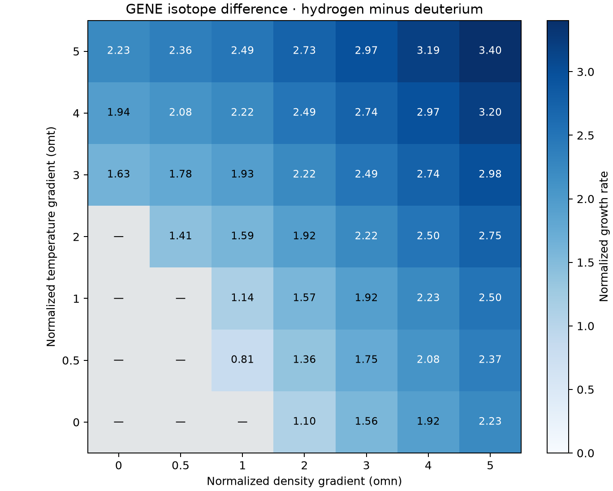

# Linear plasma stability in a magnetic dipole

This MAE 190 research project uses **GENE 3.1** to study how plasma composition, density and temperature gradients, and perpendicular wavelength affect small disturbances in a magnetic dipole. It records completed linear simulations and sets out a reproducible plan for the next experiments, focused on electron–deuterium plasma.

**Preliminary result.** At the sampled wavenumber $k_y\rho_{\mathrm{ref}}=0.7$, hydrogen had a higher normalized linear growth rate than deuterium at all 41 gradient combinations where both runs passed GENE's convergence diagnostic. At equal gradients of 2, the rates were 6.096 and 4.172. Grid independence and cross-platform agreement remain to be established.



Blank cells lack a solver-converged pair. The color and number show hydrogen minus deuterium in GENE units. The result concerns the growth of small perturbations at the simulated settings. Confinement time and nonlinear transport were outside the study.

| Start here | What it covers |
| --- | --- |
| [Beginner guide](docs/beginner_guide/README.md) | Plasma, dipoles, instabilities, GENE, and reading the figures |
| [Technical guide](docs/technical/README.md) | Gyrokinetic model, numerical settings, normalization, diagnostics, and mode structure |
| [Completed studies](docs/research_log.md) | Installation, pair plasma, isotopes, energy fits, and the wavenumber scan |
| [Findings](docs/findings.md) and [limitations](docs/limitations.md) | Data quality, claims supported by the records, and open questions |
| [Reproduction instructions](docs/reproducibility.md) and [class benchmark](benchmarks/README.md) | Regenerate figures from saved data or reproduce a simulation with independently obtained GENE |
| [Research roadmap](docs/research_roadmap.md) | Convergence study, class replication, controlled scans, and theory validation |
| [Scope and provenance](docs/provenance.md) and [session workflow](docs/research_workflow.md) | What was curated, how to review new results, and the publication plan |
| [Archived report](reports/README.md) | Original isotope report and rebuild instructions |

## Audit and regenerate figures

From the repository root, use a Python environment with the packages in [requirements.txt](requirements.txt).

```sh
python -m pip install -r requirements.txt
python scripts/reproduce.py --out generated/figures
```

The command works entirely from the archived data. It checks the inputs and run index, reproduces the thirteen free-energy fits, audits the reported counts and the low-wavenumber anomaly, and renders four comparison figures. See the [data dictionary](results/README.md) for the original tables and status labels.

## Software and research references

GENE stands for Gyrokinetic Electromagnetic Numerical Experiment. The simulation code is maintained by the GENE Development Team and is obtained separately. This archive contains the project's configurations, results, analysis, figures, and report. See the [references](docs/references.md) and [citation metadata](CITATION.cff). [GENE project](https://genecode.org/main.html) · [GENE access](https://www.genecode.org/license.html)
