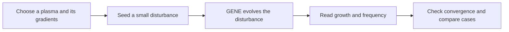

# What GENE simulates

A charged particle can circle a magnetic field line many times while the disturbance of interest changes appreciably. Gyrokinetics averages over the fast circling angle and keeps the slower motion along the field, the drifts across it, and the effect of a finite orbit size. GENE advances the distribution of particles and calculates how those particles and fields respond to one another. Our runs use an electrostatic model of the disturbance, with both species kinetic.

Normalized quantities are ratios to reference scales. Think of reporting distance in wheel diameters. The numbers depend on the chosen wheel. Here GENE uses a reference gyroradius for perpendicular length and a reference length divided by a reference speed for time. The [normalization guide](../technical/normalization.md) gives the exact conventions and identifies missing SI scales.

- **`omn`** is a normalized density gradient. Density is the number of particles per volume. A positive `omn` describes a density that falls as the radial coordinate increases.
- **`omt`** is the corresponding temperature gradient. Temperature describes the typical kinetic energy of the particles. In our gradient scans, each species had reference-point density and temperature of 1 in code units, while the spatial slopes varied.
- **`kymin`** sets the normalized binormal wavenumber. The binormal direction is across the magnetic field and tangent to the selected surface. A larger wavenumber corresponds to more closely spaced wave crests in that coordinate.

A parameter scan repeats a simulation at a set of inputs while holding selected settings fixed. Our gradient scans used seven settings on each axis to make 49 combinations per composition. Each point applies the same density gradient to both species and the same temperature gradient to both species. That measures the joint response to each gradient, so the individual species contributions are unresolved.

