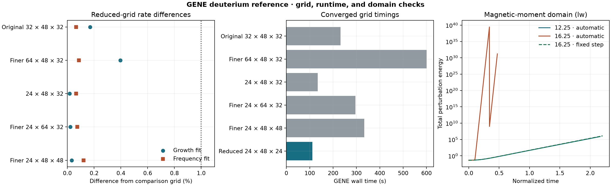

# Combined-grid and velocity-domain validation

## Start here

The reduced grid gives nearly the same growing disturbance as the original and finer grids at the deuterium reference point. Its runtime is about half that of the original. A separate test that widened the perpendicular-velocity domain ran away before convergence. The reduced grid is suitable for exploratory work at this reference point, with the current velocity extents. The fixed-step follow-up completed, but it oscillated faster than the nominal-domain case. Domain sensitivity remains open, so production scans remain on hold.

## Combined grid

All six grid configurations below were already run with automatic timestep selection at the same reference point, using `lv = 3.5` and `lw = 12.25`. Every case converged without amplitude rescaling. The first two rate columns come from the rounded GENE output. The fitted columns compare the reduced grid to each row using the same late interval, normalized time 1.49576–1.99576. The absolute relative difference uses the row's fitted value as denominator.

| Grid `nz0 × nv0 × nw0` | GENE growth | GENE real frequency | Wall time (s) | Fitted growth difference | Fitted frequency difference | Complex mode overlap |
| --- | ---: | ---: | ---: | ---: | ---: | ---: |
| Original 32 × 48 × 32 | 4.172 | 0.946 | 232.111 | 0.1698% | 0.0647% | 0.999999965 |
| 64 × 48 × 32 | 4.163 | 0.946 | 600.245 | 0.3959% | 0.0858% | 0.999999910 |
| 24 × 48 × 32 | 4.179 | 0.946 | 134.056 | 0.0174% | 0.0649% | 0.999999999 |
| 24 × 64 × 32 | 4.178 | 0.946 | 295.881 | 0.0216% | 0.0742% | 0.999999999 |
| 24 × 48 × 48 | 4.178 | 0.946 | 333.194 | 0.0322% | 0.1214% | 0.999999996 |
| Reduced 24 × 48 × 24 | 4.179 | 0.947 | 111.678 | — | — | — |

Against the original, the reduced grid's printed growth and real frequency differ by 0.168% and 0.106%, respectively. Its wall time is 51.9% lower. Projected-potential fits on the common interval give 4.178982 and 0.946787 for the reduced grid versus 4.171900 and 0.946175 for the original. The total-energy fit yields growth rates of 4.178400 and 4.171326. Across all saved comparison grids the largest fitted differences are 0.396% in growth and 0.121% in frequency. The phase convention, amplitude scaling, and interpolation of final complex potential onto the coarser geometry grid follow the [parallel-grid methodology](deuterium_parallel_grid.md#how-mode-and-frequency-were-checked). These tests meet the 1% reference-point screen, with matching rate signs and mode overlap above 0.999. They leave four-digit numerical accuracy unresolved. The finer cases refine different axes individually. A jointly finer configuration has yet to be tested.



## Velocity domains and the first extent test

GENE uses `lv` for the half-width of the parallel-velocity interval in species thermal-speed units, with $v_T=\sqrt{2T/m}$. Here `lv = 3.5`. The upper magnetic-moment limit is `lw = 12.25` in code moment units based on the species temperature and reference field. Both limits are the same inputs in all the converged grid comparisons. The recorded `field.dat` contains the complex potential, `mom_*.dat` contains velocity-integrated moments, and the energy diagnostics are integrated. The inputs disable `istep_vsp` and the case has no saved velocity-resolved perturbation or checkpoint. Those data cannot establish the behavior of the perturbation at either velocity boundary.

The equilibrium Maxwellian gives a reason to check `lw` first. For unit temperature in this normalization, the parallel Maxwellian fraction outside 3.5 is $\operatorname{erfc}(3.5)\simeq 7.43\times10^{-7}$. The dipole geometry output reaches normalized field strength about 0.4044, so the perpendicular Maxwellian factor at the cutoff there is $\exp(-0.4044\,lw)\simeq0.0071$. At `lw = 16.25` that factor would be about 0.0014. These are equilibrium proxies, not measurements or bounds on the perturbed distribution. The manually inspected GENE 3.1 patch 5 documentation defines the units and the velocity-resolved `vsp` diagnostic. The local Maxwellian implementation uses the moment multiplied by local field in its exponent. [Local source references](../references.md)

The [single new trial](../../configs/convergence/deuterium_nz24_nv48_nw24_lw1625_auto/parameters) changed only `lw` from 12.25 to 16.25 at the reduced grid. Increasing the domain with 24 points also widened the moment grid spacing. GENE selected timestep 0.000941474, smaller than 0.001087323 in the nominal-domain baseline. Energy ran away and one amplitude rescaling was logged. A run-local `GENE.stop` ended the trial after 499 steps, at normalized time 0.47074 and GENE wall time 28.785 s. The zero rates in the raw diagnostic are placeholders. There are no fitted rates or validated mode from that run. The test leaves open sensitivity to the timestep selection, the coarser moment spacing, and the wider domain.

## Wider domain with a controlled timestep

The [fixed-step input](../../configs/convergence/deuterium_nz24_nv48_nw24_lw1625_fixed_dt/parameters) is a copy of the earlier wider-domain input with only the manual timestep controls changed. It sets `calc_dt = F`, `dt_vlasov = 0.00057848`, and `ev_coll = 9300.0`. The last value is the stability estimate required by the manual stepping path of this GENE build. The physical collision input and operator are unchanged, along with the grid, extents, geometry, species, and diagnostic settings. Field timestamps verify the applied step. A monitor checked the energy and rescaling messages every two seconds and would request a run-local stop for nonfinite, nonpositive, or excessively large energy ($W>10^{12}$), or a rescaling.

In plain language, the two wider-domain runs use the same velocity grid. The control takes smaller steps in time. It tests whether changing the way the calculation advances can prevent the runaway while keeping the wider velocity range.

This setup uses the default `gau_lag` magnetic-moment quadrature. In the local GENE source, `set_mu_coordinate_vars` calls the quadrature routine and `gaulag` rescales the nodes and weights with the domain limit. At fixed `nw0`, moving from `lw = 12.25` to 16.25 multiplies the absolute gaps between the nonuniform nodes by 16.25/12.25, about **1.327**. A coarser quadrature could affect resolved velocity structure and the numerical stability margin even if the wider grid gives a stable result with another timestep. A higher `nw0` would change the quadrature node distribution and should be treated as a separate resolution control. [Local source references](../references.md)

The fixed-step run converged in **211.236 s** with 3,809 steps and zero rescalings. It reached normalized time 2.20401 without triggering the monitor. The earlier automatic run on this same wider mesh stopped after 499 steps with one rescaling. This establishes that the wider 24-point mesh can support a stable calculation at the tested smaller-step configuration. It implicates the automatic timestep configuration in the runaway and leaves open the exact stability limit and the role of individual integrator settings. The coarser moment spacing was present in both runs, so it does not by itself prevent convergence.

| Quantity | Nominal `lw = 12.25` · automatic | Wider `lw = 16.25` · fixed | Difference relative to nominal |
| --- | ---: | ---: | ---: |
| Applied timestep | 0.001087323 | 0.000578480 | 46.8% smaller |
| GENE growth | 4.179 | 4.215 | 0.861% |
| GENE signed real frequency | +0.947 | +0.994 | 4.96% |
| Common-window field growth | 4.179138 | 4.215060 | 0.860% |
| Common-window signed phase slope | +0.947036 | +0.993732 | 4.93% |
| Common-window energy growth estimate | 4.178676 | 4.214559 | 0.859% |
| GENE wall time | 111.678 s | 211.236 s | 89.1% longer |

Both compared runs passed the solver's convergence criterion. The common normalized time window was 1.66377–2.16377. Final complex potential overlap was **0.999997886** on the identical parallel spatial grid, supporting a similar dominant mode shape with a shifted frequency. The frequency difference fails the 1% screen. The two converged runs differ in both moment domain and timestep configuration, so this comparison cannot attribute the shift specifically to quadrature spacing, velocity cutoff, or timestep. Runtime is a single-run comparison of the tested configurations.

**Follow-up:** The [matched-timestep controls](deuterium_moment_controls.md) are now complete. The wider-domain frequency remained about 4.93% higher with the same timestep, and refining its moment grid to 32 points reduced that difference only slightly. The domain issue remains open.

## Which configuration to use

- **Exploratory reference:** `24 × 48 × 24`, automatic timestep, `lv = 3.5`, `lw = 12.25`. It passed the rate and mode screens, with the lowest measured wall time. Use it provisionally at this reference point.
- **Class benchmark and conservative numerical anchor:** `32 × 48 × 32` with the exact historical input and automatic stepping. It costs about 2.08 times as much as the reduced grid and supplies a finer spatial and moment grid with repeatable local archived output. The same normalized velocity extents are retained. Use it for identical-input replication and as a conservative comparison before final scientific validation. [Benchmark package](../../benchmarks/README.md)

GENE's temporal convergence flag indicates that the solver accepted a growth and frequency diagnostic. Grid agreement compares discretizations. Timestep agreement requires a time-step control on an unchanged grid. Domain agreement checks whether changing the bounds leaves the result stable and sufficiently sampled. The first two checks support the reduced grid at the reference point, the earlier timestep controls cover selected grids only, and the extent evidence is incomplete. No setting is validated across the planned scan range. Production density-gradient and wavenumber scans remain on hold. In the current two-species neutral equilibrium, independently varying one species' density gradient also requires a separate equilibrium decision. [Research roadmap](../research_roadmap.md)

## Reproduction and archived data

Run GENE with the [fixed-step extent input](../../configs/convergence/deuterium_nz24_nv48_nw24_lw1625_fixed_dt/parameters) in a fresh directory using the [single-run instructions](../reproducibility.md#reproduce-one-simulation). Use one MPI task and OpenMP thread. Monitor energy and the rescaling log and set a run-local `GENE.stop` if runaway recurs.

Use the [analysis script](../../scripts/compare_combined_grid.py) to redraw the figure from archived data. To extract the tables from local raw outputs, supply `--runs` with directories in this order: original 32 × 48 × 32, 64 × 48 × 32, 24 × 48 × 32, 24 × 64 × 32, 24 × 48 × 48, reduced 24 × 48 × 24, then reduced with `lw = 16.25` and automatic stepping, then that same wider domain with the fixed timestep.

```sh
python scripts/compare_combined_grid.py --figure generated/deuterium_combined.png
```

- [Exact input hashes, convergence, timesteps and timing](../../results/convergence/deuterium_combined/runs.csv)
- [Matched-time rates and complex overlaps](../../results/convergence/deuterium_combined/comparison.csv)
- [Terminal fit windows](../../results/convergence/deuterium_combined/late_fits.csv)
- [Raw diagnostic checksums](../../results/convergence/deuterium_combined/source_sha256.csv)
