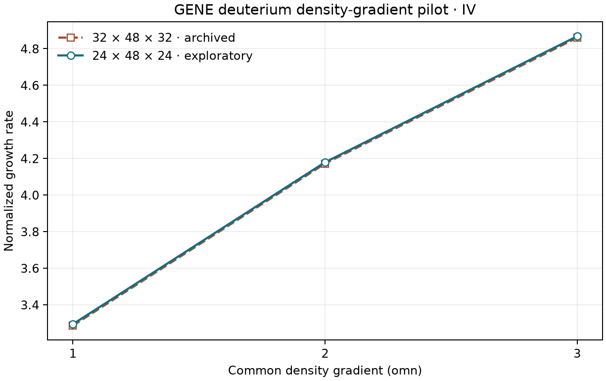
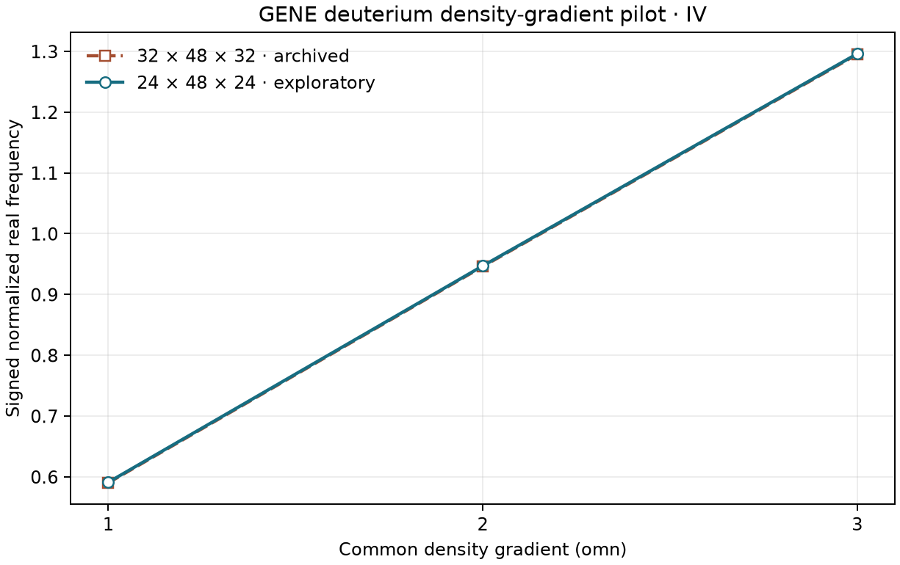

# Deuterium common density-gradient pilot

## Result

When density fell more sharply across the plasma, the dominant disturbance grew faster and oscillated faster in the same signed direction. This trend holds across the three tested settings at fixed temperature gradients and wavenumber. The economical and historical grids gave nearly the same results. No rescalings or stop conditions occurred.

| Common `omn` | Economical growth | Economical signed frequency | Economical wall time | Historical growth | Historical signed frequency |
| ---: | ---: | ---: | ---: | ---: | ---: |
| 1 | 3.294 | +0.591 | 127.690 s · new | 3.286 | +0.590 |
| 2 | 4.179 | +0.947 | 111.678 s · reused | 4.172 | +0.946 |
| 3 | 4.868 | +1.296 | 101.391 s · new | 4.860 | +1.295 |





All six IV results met GENE's temporal convergence criterion. For each same-gradient pair, the rates were fitted over a common 0.50-unit late-time window ending at that pair's earlier final time. Relative to the historical grid, the maximum differences were **0.227% for fitted growth** and **0.0749% for fitted signed phase slope**. Final complex-profile overlaps exceeded **0.99999996** across all three grid comparisons. Within the economical grid, the final profiles for `omn = 1` and 3 each overlapped the `omn = 2` profile by at least 0.99997. These checks support a similar dominant mode shape across the pilot. The observed changes cannot separate a change in drive from all changes in the eigenmode's kinetic response.

The result holds for these inputs and the original velocity-domain extents. Earlier tracked widening of `lw` changed the reference frequency by about 4.9%, so the close grid comparison at the nominal extents is not evidence of four-digit frequency accuracy or convergence across domains. Compare small physical effects with that limitation in mind. [Domain sensitivity](deuterium_moment_controls.md)

## Why change both density gradients

In the local quasineutral two-species model, the equilibrium density balance is $\sum_s q_s n_s=0$. Its radial derivative imposes $\sum_s q_s n_s\,\mathrm{omn}_s=0$ under the common gradient normalization. With equal densities and charges −1 and +1, the electron and deuterium density gradients must agree. The pilot varies the common value only. Independent gradients require a modified equilibrium or a justified approximation before generating input files. The local GENE setup checks gradient balance. [Equilibrium constraints](../research_roadmap.md#3-isolate-density-gradient-effects-within-a-valid-equilibrium)

## Inputs and reproducibility

All cases use IV, both `omt` values fixed at 2, `kymin = 0.7`, dipole geometry, and the same reference masses, densities, temperatures, Landau collision inputs and velocity extents. The economical grid is `24 × 48 × 24`, with `lv = 3.5`, `lw = 12.25` and automatic timestep selection. The [archived economical input](../../configs/convergence/deuterium_nz24_nw24_auto/parameters) is the existing `omn = 2` case. Use the [clean IV copy](../../benchmarks/classmate/parameters_deuterium_iv) for a fresh reference run. The new [omn = 1](../../configs/deuterium_density_pilot/omn_1/parameters) and [omn = 3](../../configs/deuterium_density_pilot/omn_3/parameters) inputs change only those two density-gradient entries.

The historical cases at all three gradients were incorporated without rerunning. Their respective inputs differ from the economical inputs only in `nz0` and `nw0`, both 32 in the historical runs. Both grids retain automatic stepping. The late applied timestep was about 0.00108732 on the economical grid and 0.000835 on the historical grid. The comparison therefore measures the combined effect of the spatial grid and its automatic timestep. The two new IV cases ran concurrently, each with one task and one thread, in separate fresh directories. At `omn = 2`, the recorded times were 111.678 s on the economical grid and 232.111 s on the historical grid. These single-run observations are sensitive to concurrency and machine load. See the [run procedure](../reproducibility.md#reproduce-one-simulation) and [analysis script](../../scripts/compare_density_pilot.py). To extract tables from raw data, pass the historical deuterium isotope-scan directory, the directory holding the two economical pilot runs, and the existing economical `omn = 2` run directory to `--runs`.

```sh
python scripts/compare_density_pilot.py --figures generated/deuterium_density_pilot
```

- [Run measurements](../../results/deuterium_density_pilot/runs.csv)
- [Pairwise fits and mode overlaps](../../results/deuterium_density_pilot/comparison.csv)
- [Raw diagnostic checksums](../../results/deuterium_density_pilot/source_sha256.csv)

## Next decision · wavenumber

No wavenumber cases were launched in this pilot. At common `omn = omt = 2`, the [historical deuterium wavenumber sweep](../../results/ky/original.csv) has usable comparisons at 0.5, 0.7, 1.0, 1.5 and 2.0. The 0.1 and 0.2 cases are unresolved. The 0.3 case reports growth 378.519 and frequency 220.647 with a solver flag, but is anomalous and unvalidated. Exclude it from physical trends. The published historical sweep uses the conservative grid, so label it separately when comparing to new economical results.

Start with `kymin = 0.5, 0.7, 1.0` for selected common gradients, using the pilot's 0.7 cases as anchors. Reuse the archived `omn = 2` series as a comparison and add economical repeats only where the grid matters to a conclusion. Generate separate growth-rate and signed-frequency curves and keep gaps for unresolved samples. Review rates, phase and field structure before extending curves toward smaller wavenumber or adding more gradients.
