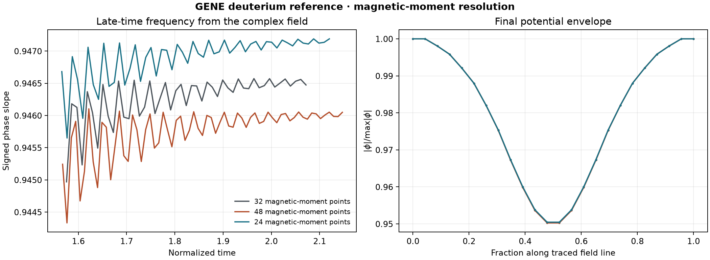

# Magnetic-moment resolution at the deuterium reference point

## In plain language

Sampling the perpendicular part of particle motion with 48 points instead of 32 produced almost the same disturbance and took about two and a half times as long. The 24-point trial also passed and was the fastest measured case. Use 24 magnetic-moment points for this reference case.

## Measured results

| Magnetic-moment grid | GENE growth rate | GENE real frequency | GENE converged | Applied timestep | Steps | GENE wall time |
| --- | ---: | ---: | --- | ---: | ---: | ---: |
| `nw0 = 32` · archived | 4.179 | 0.946 | Yes | 0.00107908279 | 1,959 | 134.056 s |
| `nw0 = 48` | 4.178 | 0.946 | Yes | 0.00090600000 | 2,419 | 333.194 s |
| `nw0 = 24` · new | 4.179 | 0.947 | Yes | 0.00108732267 | 1,989 | 111.678 s |

The reported growth difference was **0.0239%** relative to the refined run and the frequencies were equal to printed precision. The 48-point run used a **16.0% smaller** timestep and took **2.49×** the archived wall time, adding 199.138 s. The final normalized times were 2.11500 and 2.19252. The timings represent single runs.

| Common-window metric | 32 points | 48 points | Relative difference vs 48 |
| --- | ---: | ---: | ---: |
| Growth fitted from the complex potential | 4.178372 | 4.177758 | 0.0147% |
| Signed frequency fitted from the complex phase | 0.946369 | 0.945836 | 0.0564% |
| Growth fitted from total perturbation energy | 4.177849 | 4.177215 | 0.0152% |

The common fitting interval was normalized time 1.61500–2.11500. Final complex-field overlap was **0.9999999989**. Both energy histories were smooth, with zero logged amplitude rescalings and no monitor stop. The late-time growth and phase fits, energy histories, and final profiles support the same dominant mode. The rate differences are well below the 1% screen and do not materially change the result at this reference point.



[View the energy histories](../../figures/convergence/deuterium_nw32_nw48_energy.png)

## 24-point cost check

The [24-point input](../../configs/convergence/deuterium_nz24_nw24_auto/parameters) changes only `nw0` from the 32-point reference and retains automatic timestep selection. It used a fresh run directory and the same energy and rescaling monitor. Earlier runs were reused.

The run converged with smooth energy growth, zero amplitude rescalings, and no stop request. It took **111.678 s**, saving 22.378 s (**16.7%**) relative to 32 points. GENE selected a step 0.76% larger at 24 points, so this timing compares the full automatic-timestep configurations. The finer grid's runtime and rates remain available above.

| Common-window metric | 24 points | 32 points | Relative difference vs 32 |
| --- | ---: | ---: | ---: |
| Growth fitted from the complex potential | 4.179100 | 4.178372 | 0.0174% |
| Signed frequency fitted from the complex phase | 0.946982 | 0.946369 | 0.0648% |
| Growth fitted from total perturbation energy | 4.178577 | 4.177849 | 0.0174% |

The common interval was normalized time 1.61500–2.11500. Final complex-profile overlap was **0.9999999991**, supporting the same dominant mode. The 24-point case also passed against the 48-point case on their own common interval, with fitted differences of 0.0321% in growth and 0.1213% in frequency. The frequency shift is small relative to the 1% screen and remains relevant for a stricter accuracy target.

**Decision:** Use `nz0 = 24`, `nv0 = 48`, and `nw0 = 24` with automatic stepping as the working configuration for this reference point. A common-timestep run is lower priority at this tolerance. The velocity extents, combined-grid sensitivity, and behavior away from this reference point still require validation before production scans. No other simulations were started.

## Experimental controls

The magnetic moment tracks the part of particle motion perpendicular to the magnetic field. Increasing `nw0` samples this velocity coordinate more finely. The [32-point reference input](../../configs/convergence/deuterium_nz24_auto/parameters) and the [48-point input](../../configs/convergence/deuterium_nz24_nw48_auto/parameters) differ only in `nw0`. Both keep the same physical inputs, including kinetic electrons and deuterium ions, both species' gradients of 2, `kymin = 0.7`, dipole geometry, `nz0 = 24`, `nv0 = 48`, and velocity extents `lv = 3.5` and `lw = 12.25`. GENE selects the timestep independently for each grid because `calc_dt = T` in both cases.

The archived 32-point run was reused. The new input was run in a fresh case directory with the same GENE 3.1 patch 5 build, double precision, one MPI task, and one OpenMP thread. During the run a monitor checked the energy diagnostic and solver log every two seconds. It would request a run-local `GENE.stop` on nonfinite or nonpositive energy, energy above $10^{12}$, or an amplitude rescaling.

The comparison fits the log amplitude and signed unwrapped phase of each complex field projected onto its final mode. It also fits half the logarithm of total perturbation energy as a cross-check on growth. Both runs use the same 0.50-unit fitting interval ending at the earlier final field time. Relative differences use the refined `nw0 = 48` case as denominator. The preliminary screen requires both GENE convergence flags, no amplitude rescalings, same-sign nonzero rates within 1%, and final complex-profile overlap of at least 0.999.

## Reproduce the run and analysis

Run this from the research repository root using a separately installed GENE executable. It writes to a new directory.

```sh
repo_dir="$PWD"
gene_bin="$HOME/Developer/gene-complete/bin/gene_mac_arm64"
case_dir="$(mktemp -d)"
mkdir "$case_dir/out"
cp "$repo_dir/configs/convergence/deuterium_nz24_nw24_auto/parameters" "$case_dir/parameters"
(
  cd "$case_dir" &&
  export MACHINE=mac_arm64 OMP_NUM_THREADS=1 &&
  /usr/bin/time -p "$gene_bin" > run.log 2> run.stderr
)
```

The [analysis script](../../scripts/compare_magnetic_moment.py) reads completed outputs and never launches GENE. Pass `--runs <nw32-directory> <nw48-directory> <nw24-directory>` to regenerate the tables and figures, or omit it to redraw from the archived data.

```sh
python scripts/compare_magnetic_moment.py \
  --figure generated/deuterium_nw32_nw48.png \
  --energy-figure generated/deuterium_nw32_nw48_energy.png
```

- [Run measurements and input checksums](../../results/convergence/deuterium_nw32_nw48/runs.csv)
- [Common-window comparisons](../../results/convergence/deuterium_nw32_nw48/comparison.csv)
- [Terminal-window fits](../../results/convergence/deuterium_nw32_nw48/late_fits.csv)
- [Raw diagnostic checksums](../../results/convergence/deuterium_nw32_nw48/source_sha256.csv)
