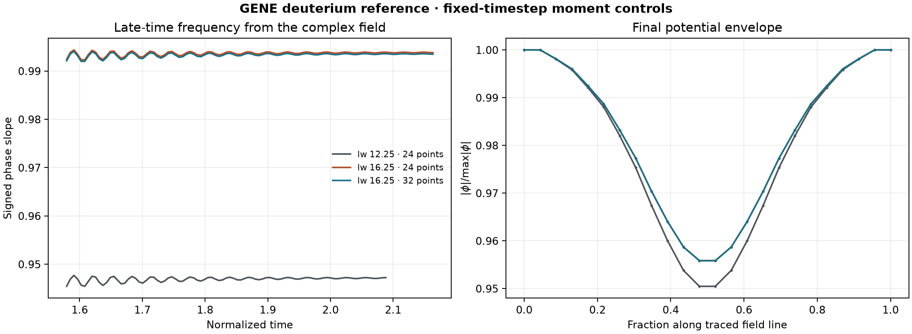

# Magnetic-moment domain and spacing at matched timestep

## What changed

Taking smaller time steps prevented the earlier runaway in the wider magnetic-moment domain. When both domains use that same small step, the disturbance in the wider domain still oscillates about 5% faster. Adding eight magnetic-moment points inside the wider domain hardly changes that result. The cases give almost the same spatial disturbance shape, and we still need to find out whether the frequency settles as the domain is widened further.

## Matched-timestep results

Every run below converged without amplitude rescaling. The applied timestep was **0.00057848** and the common fit window was **normalized time 1.62881–2.12881**.

| Case | `lw` | `nw0` | GENE growth | GENE signed frequency | Fitted growth | Fitted signed frequency | Wall time |
| --- | ---: | ---: | ---: | ---: | ---: | ---: | ---: |
| Nominal domain · new | 12.25 | 24 | 4.179 | +0.947 | 4.179111 | +0.946997 | 205.012 s |
| Wider domain · reused | 16.25 | 24 | 4.215 | +0.994 | 4.215033 | +0.993699 | 211.236 s |
| Wider domain, finer spacing · new | 16.25 | 32 | 4.215 | +0.993 | 4.214591 | +0.993382 | 276.992 s |

| Comparison | Relative fitted growth difference | Relative fitted frequency difference | Complex profile overlap | 1% screen |
| --- | ---: | ---: | ---: | --- |
| Wider 24 vs nominal 24 | 0.860% | 4.932% | 0.999997885 | Fail on frequency |
| Wider 32 vs wider 24 | 0.0105% | 0.0320% | 0.9999999998 | Pass |
| Wider 32 vs nominal 24 | 0.849% | 4.898% | 0.999997918 | Fail on frequency |

The nominal control and the original nominal automatic run both printed the same rates. At the **matched** timestep the frequency shift remains. Refining the wider-domain quadrature changes frequency by about 0.00032 in code units, compared with the approximately 0.047 shift from the nominal to wider domain. The tested spacing refinement therefore does not account for most of the frequency difference. This is evidence of sensitivity to the numerical domain setup, including the velocity cutoff and its interaction with quadrature. It does not establish a converged frequency for an arbitrarily wide domain, or a physical shift between plasmas. The energy estimates follow the field-growth estimates, and the high complex overlap supports the same dominant mode shape.



[Energy histories](../../figures/convergence/deuterium_moment_controls_energy.png)

## What remains before scans

Keep the nominal reference, labelled as exploratory, and hold the density-gradient scans. The next minimal domain check is one further expansion at the same timestep, for example `lw = 20.25` with `nw0 = 40`, compared with the `lw = 16.25`, `nw0 = 32` case. The point count is chosen to keep the average sampling density comparable. GENE's nonuniform quadrature nodes cannot be matched one for one. A rate and mode plateau would support a numerical domain choice. An independent parallel-velocity-bound check and a comparison on one representative, quasineutral off-reference gradient remain necessary before treating a production setup as validated. Independent species gradients also require a quasineutral equilibrium decision. No gradient case was run.

## Inputs and method

The [nominal-domain input](../../configs/convergence/deuterium_nz24_nv48_nw24_lw1225_fixed_dt/parameters) was copied from the saved [wider-domain control](../../configs/convergence/deuterium_nz24_nv48_nw24_lw1625_fixed_dt/parameters) with only `lw` reduced from 16.25 to 12.25. Both use `nz0 = 24`, `nv0 = 48`, `nw0 = 24`, `lv = 3.5`, and the same deuterium reference physics and manual stability inputs. GENE used the same explicit step with `calc_dt = F`, `dt_vlasov = 0.00057848`, and `ev_coll = 9300.0`. Both the original wider-domain fixed-step and original automatic runs were reused.

The conditional spacing control was authorized only if the common-window frequency difference remained at least 1%. The matched-timestep domain pair retained a **4.93%** signed-frequency difference, so the [wider-domain spacing control](../../configs/convergence/deuterium_nz24_nv48_nw32_lw1625_fixed_dt/parameters) changed only `nw0` to 32 within the wider domain. This changes the distribution of magnetic-moment quadrature nodes at constant extent. It does not add a new physical change to the intended plasma equilibrium.

All new runs used separate directories, GENE 3.1 patch 5, one MPI task and one thread. The analysis verifies the timestep from the field timestamps and checks the exact inputs. The monitors polled the energy diagnostic and rescaling messages, with a run-local stop planned for a nonfinite, nonpositive or extreme ($W>10^{12}$) energy sample or an amplitude rescaling. The comparison uses a single 0.50-unit late interval shared by all usable runs. It fits the signed phase and log amplitude of the complex potential projected onto the final profile and cross-checks growth using half the slope of log energy. The final complex overlap removes overall amplitude and phase. Relative differences use the named reference of each comparison as denominator.

## Reproducible archive

The new runs used exact inputs copied to fresh directories and the [single-run procedure](../reproducibility.md#reproduce-one-simulation). The [analysis script](../../scripts/compare_moment_controls.py) redraws the figures from the archived data. To regenerate the tables, use `--runs` with the nominal fixed-step directory, wider 24-point fixed-step directory, and wider 32-point fixed-step directory in that order.

```sh
python scripts/compare_moment_controls.py \
  --figure generated/deuterium_moment_controls.png \
  --energy-figure generated/deuterium_moment_controls_energy.png
```

- [Run timing, convergence, and verified timesteps](../../results/convergence/deuterium_moment_controls/runs.csv)
- [Matched-window rates and mode overlaps](../../results/convergence/deuterium_moment_controls/comparison.csv)
- [Source checksums](../../results/convergence/deuterium_moment_controls/source_sha256.csv)
