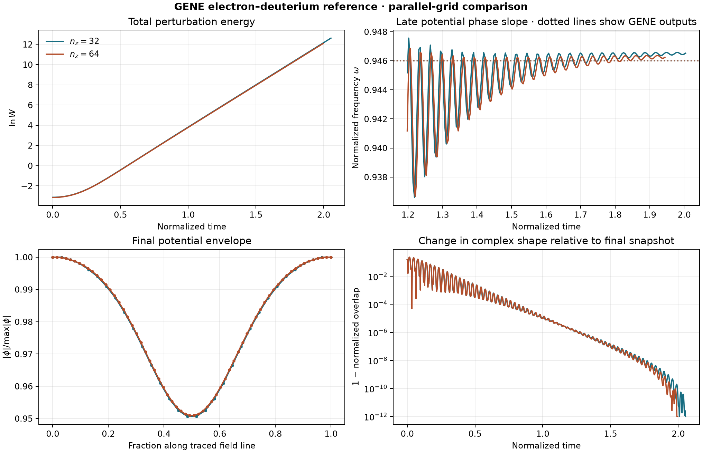

# Deuterium reference with 32 and 64 parallel grid points

## In plain language

Doubling the number of points along the magnetic field line made almost no difference to the measured disturbance. The disturbance grew about 0.22% more slowly on the finer grid, and both simulations reported the same oscillation rate to the displayed precision. Their final disturbance shapes nearly overlap. The 32-point result took 3 minutes 52 seconds, compared with 10 minutes on the 64-point grid. For this case, 32 points are a good working choice while we check whether a cheaper grid and a smaller timestep give the same answer.

## Measured comparison

| Quantity | 32 points, archived | 64 points, new | Absolute difference | Relative difference vs 64 |
| --- | ---: | ---: | ---: | ---: |
| Normalized growth rate $\gamma$ | 4.172 | 4.163 | 0.009 | 0.216% |
| Normalized real frequency $\omega$ | 0.946 | 0.946 | 0.000 at output precision | 0.000% at output precision |
| GENE temporal convergence | Yes | Yes | — | — |
| GENE wall-clock time | 232.111 s | 600.245 s | 368.134 s | 61.331% |
| Computed steps | 2,459 | 3,449 | 990 | — |
| Applied timestep from field timestamps | 0.0008350 | 0.00057848 | — | — |
| Last field time (normalized) | 2.05410 | 1.99576 | — | — |

Relative differences are $|Q_{32}-Q_{64}|/|Q_{64}|$. The 64-point run cost **2.59×** the archived 32-point wall time, a 158.60% increase relative to the 32-point run. The finer grid took about 40% more steps despite ending slightly earlier in normalized time because the timestep selected by GENE was about 31% smaller. The mean wall time per computed step also rose, from 0.093 s to 0.173 s in the solver logs. The external timer for the new invocation was 600.53 s.



## Technical interpretation

A fit on the same late interval ($t=1.49576$ to $1.99576$) gave field-amplitude growth rates of 4.17190 and 4.16250, a **0.226%** difference, and signed phase slopes of 0.946175 and 0.945975, a **0.021%** difference. The total-energy growth estimates were 4.17133 and 4.16193. Over the three terminal windows, the frequency estimates ranged from 0.94591 to 0.94645 for 32 points and from 0.94546 to 0.94620 for 64 points. Those ranges support the displayed solver frequency near 0.946 and reveal time-window sensitivity above the fourth-significant-digit scale. The digits in the fitted values are retained to show the numerical comparison.

The final complex profiles have overlap **0.99999997** after interpolation, with a relative residual of **0.0233%** after complex rescaling. In the common fitting interval each run's overlap with its own final profile stayed above 0.9999998. The spatial agreement, the same frequency sign, and the late-time energy growth all support the same dominant linear mode. Both rates meet the roadmap's preliminary 1% screen for this case. The time step changed with the grid, and neither this comparison nor the temporal convergence flags establish independent spatial and temporal convergence.

## What stayed fixed

The archived deuterium input matches the [benchmark file](../../benchmarks/parameters) byte for byte. The [64-point input](../../configs/convergence/deuterium_nz64/parameters) changes only `nz0` from 32 to 64. The original namelist files are the complete input record, including commented defaults.

| Group | Input |
| --- | --- |
| Species | Electrons $(q=-1,m=0.00054462)$ and deuterium ions $(q=+1,m=2.0)$ in code units. Both have `temp = dens = 1` and `omn = omt = 2`. The reference mass is one proton mass. |
| Geometry | Ring dipole with `r0_dipole = 0.4`, `Icurr_dipole = 750`, `c_surf_dipole = 1.2`, `c_dt_dipole = 1e-5`, `q0 = shat = 0`, `minor_r = major_R = 1`, `dpdx_term = 'gradB_eq_curv'`, `dpdx_pm = 0`, and `norm_flux_projection = F`. |
| Modes and velocity domain | `kymin = 0.7`, `ky0_ind = 1`, `nx0 = nky0 = 1`, `lx = 1`, `nexc = 0`, `adapt_lx = F`, `nv0 = 48`, `nw0 = 32`, `lv = 3.5`, `lw = 12.25`, and `is_bsg = F`. |
| Evolution | Linear initial-value run, `nonlinear = F`, `comp_type = 'IV'`, `init_cond = 'alm'`, `beta = debye2 = 0`, Landau collisions with `coll = 0.01` and `coll_cons_model = 'xu_rosenbluth'`, `hyp_z = 4`, `hyp_on_h = F`, and `hyp_z_with_dz_prefactor = F`. |
| Integrator and limits | Both resolved runs use RK4 with `calc_dt = T`, `ntimesteps = 5000`, and `timelim = 86000`. GENE determines the timestep for each discretization and may select different runtime optimization settings. |
| Diagnostics | `diagdir = './out'`, checkpoint read/write disabled, field/moment/density/energy diagnostics every step via `istep_field = istep_mom = istep_nrg = istep_energy = 1`, `istep_omega = 10`, `istep_vsp = istep_schpt = 0`, and `write_std = T`. |

The runs report GENE 3.1 patch 5, source revision `a0d2f213c5e22eed3b9f1bf4e40530c6292a9143`, double precision, one MPI task and one OpenMP thread. The archived baseline was read from `runs/isotope_scan/deuterium/omn_2_omt_2` in the original checkout. It has the exact input, the convergence exit line in `run.log`, the reported frequency and growth rate in `out/omega.dat`, and complete field and energy histories. Its runtime is historical and supplies a single comparison point. Timing differences can include host load and diagnostics costs. The new single-rank run emitted a TCP listener warning in the restricted runner, completed with exit status 0, and wrote the expected diagnostics.

## Execution and reproduction

The 64-point run was launched from a fresh directory. The command below reproduces it in another fresh directory, assuming it is run from the research repository root and the recorded GENE build is available separately. Copy and output locations are entirely within the new run directory.

```sh
repo_dir="$PWD"
gene_bin="$HOME/Developer/gene-complete/bin/gene_mac_arm64"
case_dir="$(mktemp -d)"
mkdir "$case_dir/out"
cp "$repo_dir/configs/convergence/deuterium_nz64/parameters" "$case_dir/parameters"
(
  cd "$case_dir" &&
  export MACHINE=mac_arm64 OMP_NUM_THREADS=1 &&
  /usr/bin/time -p "$gene_bin" > run.log 2> run.stderr
)
```

Run the following with the repository's Python dependencies to regenerate the published figure entirely from the compact datasets. To regenerate the tables as well, pass `--runs <archived-nz32-directory> <completed-nz64-directory>`. The analysis script reads those directories, writes derived data under the specified `--data` path, and never starts GENE.

```sh
python scripts/compare_parallel_resolution.py --figure generated/deuterium_nz32_nz64.png
```

- [Run measurements and input checksums](../../results/convergence/deuterium_nz32_nz64/runs.csv)
- [Relative differences and complex-profile comparison](../../results/convergence/deuterium_nz32_nz64/comparison.csv)
- [Time-window fits and stability of the field shape](../../results/convergence/deuterium_nz32_nz64/late_fits.csv)
- [SHA-256 checksums of source diagnostics](../../results/convergence/deuterium_nz32_nz64/source_sha256.csv)
- [Derived energy and field histories](../../results/convergence/deuterium_nz32_nz64/)

## How mode and frequency were checked

GENE's temporal convergence diagnostic uses the complex potential at successive times. For an independent post-processing check, the script projects each field snapshot onto that run's final complex profile and fits the logarithm of the amplitude and the unwrapped phase against normalized time. With GENE's sign convention, the two slopes give $gamma$ and $omega$. An energy check fits $\tfrac12ln W$ against time. The script discards duplicate diagnostic timestamps, fits the final 0.25, 0.50 and 0.75 normalized time units, and repeats the fit on a common 0.50-unit interval ending at the shorter run's final time.

To compare shapes, the script interpolates the complex 64-point final profile onto the 32 stored geometry samples using normalized traced position. It calculates the absolute normalized inner product and the relative residual after optimal complex scaling, so phase and overall amplitude do not affect the comparison. The within-run overlap history checks whether the complex shape was stable late in the run. High overlap and consistent phase support a shared dominant mode and give more evidence than the final solver flag alone. The fits use the same numerical solution as GENE and supply no independent validation of the continuum frequency. The tables also record a post-processed version of the solver’s spatial rate-spread term, using all saved 10-sample intervals and the actual timestamp difference. GENE evaluates the stop test only at its diagnostic cadence. Its default tolerance is $0.1\,\texttt{omega\_prec}=10^{-4}$ for the square root of the spread term.

## Next tests

1. At `nz0 = 32`, run one timestep control near the 64-point timestep ($5.78\times10^{-4}$ in code time), retaining enough steps to cover a comparable normalized time. Compare the phase fit, growth, and complex envelope with both existing cases. This isolates the timestep contribution at a fixed spatial grid.
2. If the timestep control is consistent, run one lower-cost `nz0 = 24` case at `nv0 = 48` and `nw0 = 32`, with the timestep controlled consistently. Keep 32 points if 24 fails the 1% screen or changes the dominant mode. Test `nz0 = 96` only if the matched-timestep evidence exposes a spatial discrepancy that needs resolving.

These tests are proposals. The 32- and 64-point comparison used the existing 32-point archive and one new run.
