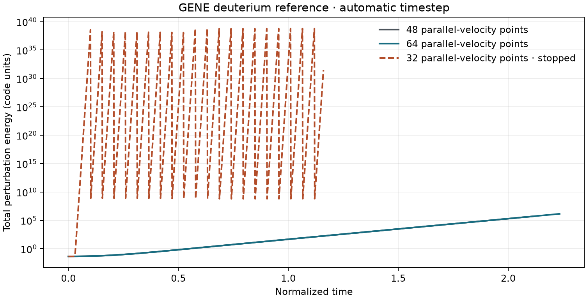

# Parallel-velocity resolution at the deuterium reference point

## In plain language

Using 64 instead of 48 points to sample motion along the magnetic field gave nearly the same disturbance and took more than twice as long. The 32-point trial grew out of control with automatic timestep selection. Keep 48 parallel-velocity points for this reference case.

## Measured results

| Parallel-velocity grid | GENE growth rate | GENE real frequency | GENE converged | Applied timestep | Steps | GENE wall time |
| --- | ---: | ---: | --- | ---: | ---: | ---: |
| `nv0 = 48` · archived | 4.179 | 0.946 | Yes | 0.00107908 | 1,959 | 134.056 s |
| `nv0 = 64` | 4.178 | 0.946 | Yes | 0.00078100 | 2,859 | 295.881 s |
| `nv0 = 32` · new | — | — | No · stopped | 0.00128879 | 899 | 48.225 s to stop |

The reported growth rates differ by 0.001 (**0.0239%** relative to 64 points). Both frequencies print as 0.946. The finer grid took **2.21×** as long, adding 161.825 s. Its automatically selected step was 27.6% smaller and it took 900 more steps. The archived and new cases ended at normalized times of 2.11500 and 2.23366. These are single-run timings.


## Technical interpretation

On the common time interval 1.61500–2.11500, the field growth fits were 4.178372 and 4.178199 (**0.00415%** relative difference), and the signed phase slopes were 0.946369 and 0.946279 (**0.00952%**). The energy-growth estimates were 4.177849 and 4.177677. The final complex potential profiles overlap at **0.9999999991** on the same parallel spatial grid. The diagnostic rates and the common-time fits pass the 1% screen and support the same dominant mode. The terminal-window fit variation limits how many digits can be compared reliably.

Only `nv0` changed in the input, and the timestep selected by GENE changed as a consequence. This compares the two practical configurations with automatic timestep selection. It leaves a same-timestep velocity-grid comparison and long-time recurrence untested. Retain `nv0 = 48` as the working reference. The 32-point trial below tests whether sampling velocity more coarsely could reduce cost.

## 32-point automatic run

The [32-point input](../../configs/convergence/deuterium_nz24_nv32_auto/parameters) differs from the 48-point input only in `nv0`. GENE chose a normalized timestep of 0.0012887872, about 19.4% larger than the 48-point step. The recorded energy exhibited runaway growth and the solver logged 20 amplitude rescalings. Near normalized time 0.25 the 32-point diagnostic recorded about $1.1\times10^{33}$ in total perturbation energy, compared with about 0.096 in the two converged cases. Discontinuities in the plot reflect rescaling, so amplitudes across a rescaling event cannot be compared as physical growth.

A run-local `GENE.stop` requested a controlled exit once this behavior was observed. GENE stopped without its linear-growth convergence flag after 899 reported steps, at normalized time 1.15991. The all-zero growth and frequency entries in the raw omega output are placeholders. The study retains the energy history and stop metadata without fitting a physical growth rate or comparing a final mode for the stopped case. The 48.225 s time records an incomplete trial.



**Decision:** Keep `nz0 = 24`, `nv0 = 48`, and `nw0 = 32` with automatic timestep selection at the reference point. The trial rules out 32 points with the tested automatic step. It leaves the cause of the instability open because the applied timestep also changed. One follow-up at 32 points with the previously tested smaller timestep near 0.00057848 would check whether the instability persists at fixed grid size. No follow-up run was started.

## Experimental controls

The trial reused the [24-point automatic-timestep reference](../../configs/convergence/deuterium_nz24_auto/parameters). The [64-velocity-point input](../../configs/convergence/deuterium_nz24_nv64_auto/parameters) changes only `nv0` from 48 to 64. All three runs use `nz0 = 24`, `nw0 = 32`, the parallel-velocity and magnetic-moment extent parameters `lv = 3.5` and `lw = 12.25`, and the same electron–deuterium composition, gradients, `kymin = 0.7`, geometry, and diagnostics. Increasing the number of velocity points at fixed extent improves sampling over the same velocity domain. All three cases retain `calc_dt = T`, so GENE can apply a different stable timestep when the velocity grid changes.

GENE 3.1 patch 5 was run in double precision with one MPI rank and one OpenMP thread. The analysis uses a common 0.50-unit interval ending at the earlier final field time. It fits the log amplitude and signed unwrapped phase of each complex potential projected onto its final mode shape, and checks growth against half the slope of log total perturbation energy. The overlap compares the final complex profiles, allowing for overall amplitude and phase. The preliminary screen requires both solver convergence flags, rates with matching signs and less than 1% relative difference, and complex overlap of at least 0.999.

## Reproduce the comparison

From the research repository root, copy the exact input into a fresh simulation directory. This command requires a separately installed GENE executable.

```sh
repo_dir="$PWD"
gene_bin="$HOME/Developer/gene-complete/bin/gene_mac_arm64"
case_dir="$(mktemp -d)"
mkdir "$case_dir/out"
cp "$repo_dir/configs/convergence/deuterium_nz24_nv32_auto/parameters" "$case_dir/parameters"
(
  cd "$case_dir" &&
  export MACHINE=mac_arm64 OMP_NUM_THREADS=1 &&
  /usr/bin/time -p "$gene_bin" > run.log 2> run.stderr
)
```

Monitor the energy diagnostic when reproducing the 32-point trial. The original run used `touch GENE.stop` in its fresh run directory to request a controlled exit. The [offline analysis](../../scripts/compare_parallel_velocity.py) accepts the 48-, 64-, and stopped 32-point run directories in that order through `--runs`. Both figures can also be regenerated directly from the published data.

```sh
python scripts/compare_parallel_velocity.py \
  --figure generated/deuterium_nv48_nv64.png \
  --energy-figure generated/deuterium_nv32_auto_energy.png
```

- [Run results, timing, and input hashes](../../results/convergence/deuterium_nv48_nv64/runs.csv)
- [Pairwise rates and mode overlap](../../results/convergence/deuterium_nv48_nv64/comparison.csv)
- [Terminal-window fit checks](../../results/convergence/deuterium_nv48_nv64/late_fits.csv)
- [Raw diagnostic checksums](../../results/convergence/deuterium_nv48_nv64/source_sha256.csv)
