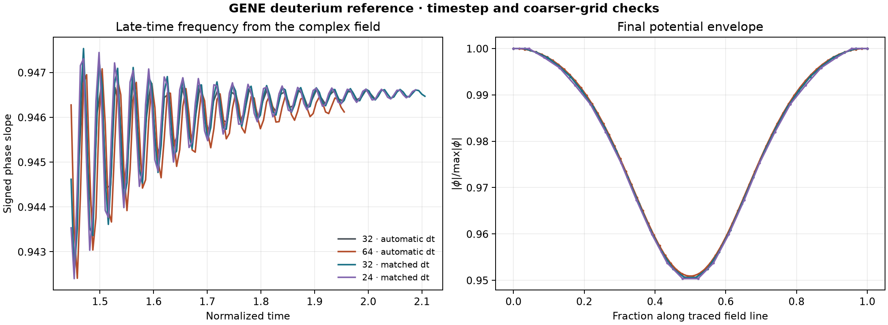

# Deuterium timestep control and cheaper parallel grid

## In plain language

The smaller timestep left the 32-point answer essentially unchanged. We then used that same timestep with 24 points along the field line. The disturbance kept the same shape, and its growth rate changed by about 0.15%. The 24-point case saved 46.493 seconds compared with 32 points at the same timestep. The archived 32-point case with automatic timestep selection is still the fastest run we have measured.

## Measured results

| Parallel grid and timestep | Applied timestep | Growth rate | Signed real frequency | GENE converged | Steps | GENE wall time |
| --- | ---: | ---: | ---: | --- | ---: | ---: |
| 32, automatic (archived) | 0.0008350 | 4.172 | 0.946 | Yes | 2,459 | 232.111 s |
| 64, automatic (prior run) | 0.00057848035 | 4.163 | 0.946 | Yes | 3,449 | 600.245 s |
| 32, matched (new) | 0.00057848035 | 4.172 | 0.946 | Yes | 3,709 | 311.778 s |
| 24, matched (new) | 0.00057848035 | 4.178 | 0.947 | Yes | 3,679 | 265.285 s |

The 24/32 comparison at matched timestep gives a **0.144%** difference in reported growth and **0.106%** in reported frequency, relative to the 32-point result. Common-window field growth differs by **0.152%** and the fitted phase slopes are 0.9463838 and 0.9463847 (a relative difference of about **0.000096%**). The complex-profile overlap is **0.99999996**. The one-unit difference in the last displayed frequency digit is larger than the difference between the common-window fits. It should not be interpreted as a resolved physical frequency shift. The fits and envelopes support the same dominant mode.



The 24-point matched run used **14.9% less** GENE wall time than the 32-point matched run, and **14.3% more** than the archived 32-point automatic run. The latter comparison mixes timestep choices and run conditions. The automatic step for the 24-point grid was outside this experiment.

## Working grid and next test

Use the archived 32-point automatic case as the performance baseline. The 24-point grid passes the spatial screen at the tested timestep and is a candidate for a cheaper production configuration. One 24-point run with automatic timestep selection is the smallest next test of that possibility. Compare its rates, mode shape, and runtime to the 24-point matched case and the 32-point automatic baseline. Once the parallel choice is settled, change `nv0` separately at fixed `nw0`. No further cases were launched.

## Experimental controls

The [prior parallel-grid comparison](deuterium_parallel_grid.md) changed only the spatial resolution input, but GENE automatically applied a smaller timestep at 64 points. Here the [32-point matched-timestep input](../../configs/convergence/deuterium_nz32_fixed_dt/parameters) retains the archived deuterium physics and grid while setting `calc_dt = F`, `dt_vlasov = 0.0005784803539135`, and `ev_coll = 9300.0`. The imposed timestep is the measured step of the earlier 64-point run. The collisional value is a conservative stability input for the timestep calculation. It does not change `coll = 0.01` or the Landau operator. Both settings are required for manual timestep selection with this collision configuration. GENE's collision stability bound remained above the requested step. The 5,000-step cap permits about 2.89 units of normalized time with the smaller step.

An initialization attempt using `dt_max` alone was rejected by GENE before time integration. It was retained in a separate local folder and is excluded from runtime comparisons. The simulation was started afresh using the two inputs above.

The 24-point trial changes only `nz0` relative to the matched-timestep 32-point run. Both use the same velocity grids (48 parallel-velocity points and 32 magnetic-moment points) and the same diagnostics cadence. [24-point input](../../configs/convergence/deuterium_nz24_fixed_dt/parameters)

All fits use the original case's signed frequency convention. For each comparison the script fits both cases on the same 0.50-unit interval ending at the earlier final time. The acceptance screen requires both GENE convergence flags, same-sign rates, relative differences below 1% for diagnostic and fitted rates, and final complex-profile overlap at least 0.999. Profiles are compared on the coarser stored geometry grid. The overlap threshold is a practical check of mode identity, and the rates and shapes still pertain to this reference point.

## What the 32-point control establishes

At fixed spatial grid, the matched-timestep run reported the same numbers as the archived automatic-step run at displayed precision. On their common late interval ($t=1.5541$ to $2.0541$), the field-growth fits were 4.1719642 and 4.1719632, and the phase slopes were 0.9462895 and 0.9462887. This places the observed timestep effect well below the original 32/64 growth-rate difference for these settings. The 32/64 matched-step comparison still shows a 0.226% field-growth difference and a 0.0210% phase-slope difference. This supports a primarily spatial origin for the observed 32/64 difference. Window sensitivity and the limited grids still constrain the meaningful precision of these digits.

## Reproduce the matched-timestep runs

From the repository root, choose the input for the case you intend to run. Each invocation creates a fresh output directory.

```sh
repo_dir="$PWD"
gene_bin="$HOME/Developer/gene-complete/bin/gene_mac_arm64"
input="$repo_dir/configs/convergence/deuterium_nz32_fixed_dt/parameters"
case_dir="$(mktemp -d)"
mkdir "$case_dir/out"
cp "$input" "$case_dir/parameters"
(
  cd "$case_dir" &&
  export MACHINE=mac_arm64 OMP_NUM_THREADS=1 &&
  /usr/bin/time -p "$gene_bin" > run.log 2> run.stderr
)
```

The [offline analysis script](../../scripts/compare_parallel_followup.py) reads completed runs. To regenerate tables and the figure, use `--runs` with the archived 32-point automatic case, the 64-point automatic case, the 32-point matched-timestep case, then the 24-point matched-timestep case. It also redraws the figure from the committed reduced data without any raw GENE outputs.

```sh
python scripts/compare_parallel_followup.py --figure generated/deuterium_timestep_nz24.png
```

- [Measured rates, timings, and input hashes](../../results/convergence/deuterium_timestep_nz24/runs.csv)
- [Pairwise comparisons with common-window fits](../../results/convergence/deuterium_timestep_nz24/comparison.csv)
- [Terminal-window checks](../../results/convergence/deuterium_timestep_nz24/late_fits.csv)
- [Source diagnostic checksums](../../results/convergence/deuterium_timestep_nz24/source_sha256.csv)
