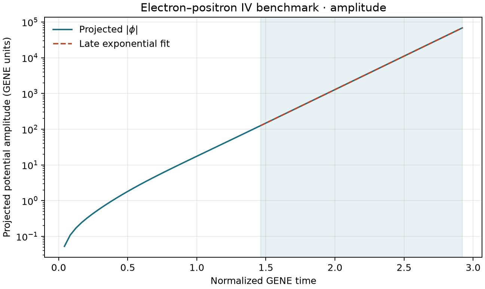
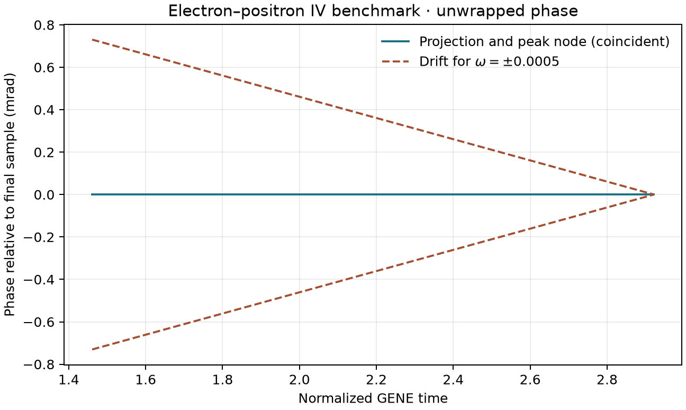

# Frequency verification for the electron–positron IV benchmark

## Result

The dominant disturbance grows exponentially while its Fourier phase stays fixed. At the specified grid and initialization it is a **purely growing, non-oscillating IV mode** to the precision tested. GENE reports normalized growth **4.314** and signed frequency **0.000**. A stationary phase means that this disturbance’s peaks grow in place. The equal-mass, equal-temperature pair plasma has opposite charge-dependent drift responses, and zero-frequency growing modes are known in electrostatic dipole pair-plasma calculations. This benchmark establishes the behavior of the selected mode at this input. [Kennedy et al., *Linear gyrokinetics of electron–positron plasmas in closed field-line systems*](https://www.cambridge.org/core/journals/journal-of-plasma-physics/article/linear-gyrokinetics-of-electronpositron-plasmas-in-closed-fieldline-systems/DDDA441F5C292F9AC735E6BF4579B088)

## Diagnostic checks

The original and cleaned inputs differ only in the removal of three inactive eigenvalue-solver keys and their separator. One cleaned-input IV run was needed to confirm that these deletions left the outputs unchanged. It met GENE’s convergence check in 69 reported steps without amplitude rescalings. The binary potential trace and both frequency files were byte-identical to the original local IV run. The automatic timestep was 0.041739504923 in normalized time. The cleaned run took 5.203 s and the original 7.011 s. These timings are individual local measurements. [Input](../../benchmarks/classmate/parameters.txt) · [Verification record and raw-file hashes](../../results/pair/classmate_iv/verification.json)

The binary diagnostic contained 71 timestamps, including an initial all-zero field with undefined phase. The remaining 70 snapshots contained one complex potential value at each of the 24 parallel grid nodes. The real component of every stored value was exactly zero in this choice of global phase. The strongest node maintained the same sign in the imaginary component. To test the full spatial profile, project each snapshot onto the final profile, then fit $\log |a(t)|$ and unwrap and fit $\arg[a(t)/a(t_{\rm end})]$, where $a(t)$ is the complex projection. Independently fit the phase at the peak node. The rate convention is $a(t)\propto\exp[(\gamma+i\omega)t]$, so a positive phase slope is positive signed frequency in the GENE convention.

| Actual normalized fit interval | Samples | Projected growth | Half-log free-energy growth | Projected and peak signed frequency |
| --- | ---: | ---: | ---: | ---: |
| 1.461–2.922 | 36 | 4.31444 | 4.31237 | 0 |
| 1.962–2.922 | 24 | 4.31448 | 4.31429 | 0 |
| 2.212–2.922 | 18 | 4.31404 | 4.31436 | 0 |
| 2.463–2.922 | 12 | 4.31380 | 4.31428 | 0 |

The longest fit has a log-amplitude RMS residual of $3.79\times10^{-4}$. The residual falls to $7.52\times10^{-6}$ in the shortest fit. Over the longest interval the largest relative norm of the field left after projecting onto the final shape was $1.45\times10^{-3}$. It fell to $3.50\times10^{-5}$ over the shortest interval. The growth fits cluster near 4.314 and the late shape stabilizes. The extra fit digits characterize window sensitivity. [Full fit results](../../results/pair/classmate_iv/late_fits.csv)

GENE 3.1 patch 5 estimates the complex rate from the logarithm of the field ratio over its monitoring interval and averages spatially with weights proportional to the earlier field magnitude. Reconstructing that estimator over the last ten saved steps gave $4.313801 + 0i$. The solver’s default `omega_prec = 0.001` gives three decimal places in `omega.dat`. `0.000` by itself therefore supports a display bound of about **$|\omega| \lesssim 5\times10^{-4}$** for the estimated signed rate. The direct complex-field fit provides stronger evidence that the observed phase is stationary. GENE’s species free-energy diagnostic shows an opposing signed contribution from each species, −2.612 for positrons and +2.612 for electrons, which sum to zero at the printed precision. Those contributions decompose the selected mode’s energy response. The field and its time history independently establish the phase result.

## What the observation window resolves

The longest fit spans 1.461 normalized time units and over six growth e-foldings. A sustained drift of $|\omega|=5\times10^{-4}$ would shift phase by $7.30\times10^{-4}$ radians across that window. A synthetic rotation of the saved complex trace recovered both signs at that rate and at $10^{-8}$, which would shift phase by about $1.46\times10^{-8}$ radians. This checks sensitivity of the extraction to a steady drift on the sampled trace. It is neither a bound on continuum physics nor a guarantee about other initial conditions or builds. Report **4.314** and **0.000**, with the display bound, for comparisons.

There is no resolved evidence for a different oscillatory mode dominating this IV time history. A weaker, decaying or unexcited oscillatory mode can coexist with the selected mode. The residual measures departures from its spatial shape and does not exclude a much smaller component with a similar spatial shape or an unresolved beat. The run covers one initialization, one grid and one timestep policy. Cross-platform reproducibility, convergence with grid or timestep refinement, and the rest of the mode spectrum remain open.

Run `python scripts/check_pair_benchmark.py` from the repository root to regenerate the figures and fits from the committed data. It reads no simulation executable. [Field projection and peak samples](../../results/pair/classmate_iv/field_history.csv) · [Free-energy trace](../../results/pair/classmate_iv/energy_history.csv)
