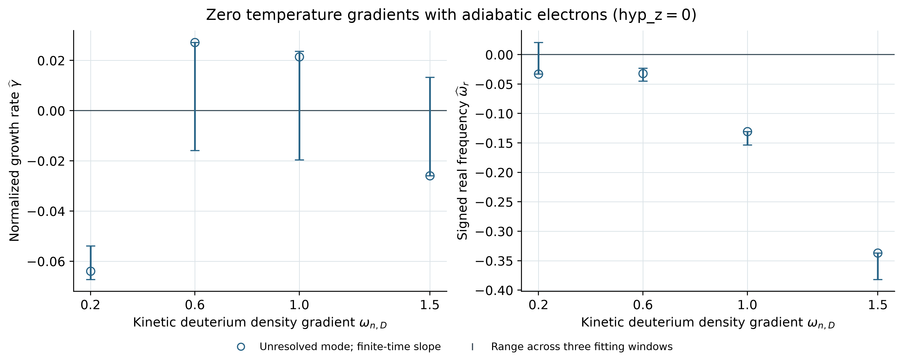
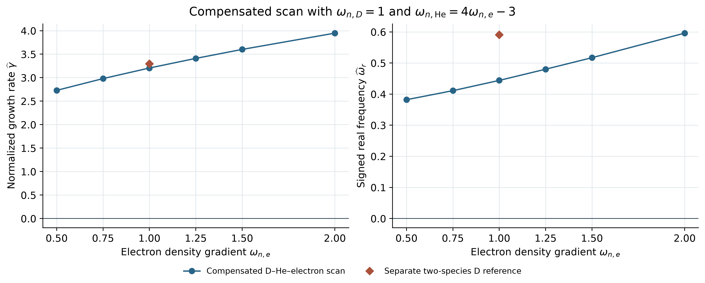

# Adiabatic dissipation controls and helium-compensated gradients

The [four-page report](MAE190_Additional_Experiments.pdf) covers two GENE IV studies conducted with the existing ARM64 build. [Exact inputs and build lineage](../../configs/additional_experiments) and [numerical results](../../results/additional_experiments) are included.

## Adiabatic electrons at zero temperature gradients

At common density gradients 0.6 and 1.5, removing parallel hyperdiffusion changed the free-energy loss by normalized time 52 from 46.1% and 42.5% to approximately zero. Native free-energy balance assigns the observed loss to parallel hyperdiffusion. Complex potential fits remain sensitive to the fitting window. The four target density gradients 0.2, 0.6, 1.0, and 1.5 remain unresolved as eigenmodes.

The 96-point parallel-velocity control at the original step produced runaway free energy even though the native convergence flag was set. Halving the step restored bounded energy and extended the pre-recurrence record. Increasing parallel spatial resolution reduced the relative high-wavenumber content. The resulting histories still leave a physical damping rate and unique real frequency unresolved. [Hyperdiffusion figure](Figures/A_05_hyperdiffusion.pdf) · [Fitting windows and residuals](../../results/additional_experiments/field_fits.csv)

## Kinetic electrons with deuterium and helium

At fixed deuterium density gradient 1, electron density gradient varied from 0.5 to 2. Helium's gradient followed the charge-balanced relation omn_He = 4 omn_e − 3, including the verified negative endpoint. Across the six qualified points, growth rose from 2.729 to 3.948 and signed frequency from +0.382 to +0.596. The separate two-species deuterium reference at shared gradient 1 gave 3.294 and +0.591.

The tested grid and timestep controls changed fitted rates by about 0.20% or less in growth and 0.034% or less in frequency. They probe two representative points. The trends describe the coupled electron and helium gradient path. [Scan table](../../results/additional_experiments/B_compensated_results.csv) · [Numerical controls](Figures/B_04_numerical_controls.pdf)

## Reproduction and evidence

From the repository root, run the following using the project's [Python dependencies](../../requirements.txt).

    python scripts/plot_additional_experiments.py

The command regenerates all ten PDF and PNG figures in the ignored generated directory using portable diagnostic extracts. To rebuild the report with the checked-in figures and tables, work from this report directory.

    latexmk -pdf -outdir=../../generated/additional_report LaTeX/report.tex

The [run index](../../results/additional_experiments/all_runs.csv) separates reused archives, the 22 new integrations, the rejected numerical runaway, and seven invalid startup attempts. [Timings](../../results/additional_experiments/runtime.json) record 2,987.956 s of summed native wall time for the new integrations and 1,083.492 s elapsed with overlapping jobs. [Diagnostic checksums](../../results/additional_experiments/diagnostic_checksums.csv) identify the raw evidence in the full local experiment bundle. The repository includes extracted field and energy histories, inputs, and figures. The original binary run outputs are held in the local experiment archive.

The [raw-data analysis sources](../../scripts/archive/additional_experiments) are preserved for use with the local archive. See their readme for the expected layout.
